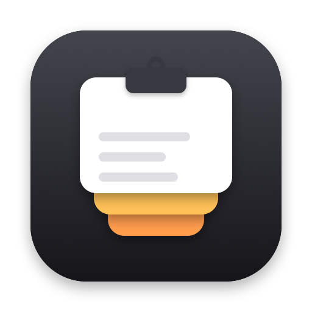

# ClipShelf

ClipShelf is a small, local-only macOS clipboard history app. It lives in the menu bar, records text, rich text, links, images, and Finder file references, and restores any entry to the system clipboard for the next normal `⌘V`.

## Requirements

- macOS 13 or newer
- Xcode 15 or newer (tested with Xcode 26.3)

## Run it

Build a normal local application bundle and open it:

```sh
make run
```

The app will appear as a clipboard icon in the menu bar. The built application is at `build/ClipShelf.app`; you can drag it into `/Applications` if you want to keep it there.

You can also open `Package.swift` in Xcode and run the `ClipShelf` executable target.

## Use it

1. Leave ClipShelf running in the menu bar.
2. Copy text, a link, an image, or Finder files normally.
3. Open the clipboard icon and choose a history entry.
4. Press `⌘V` in the destination app.

Copying something that is already in the history moves it back to the top instead of adding a duplicate. Text is matched on its plain-text content, so the same text copied from different apps counts as one entry.

Right-click a history row to pin it to the top or delete it. Up to 3 entries can be pinned. Pinned entries are kept when clearing history and never expire.

### Quick paste

Press `⌃⌥V` (Control-Option-V) in any app to open a small list next to your text cursor. It shows your most recently used pinned entry and your two most recent copies, or your three most recent copies if nothing is pinned. Press `1`, `2` or `3`, or use the arrow keys and `Return`, and ClipShelf pastes that entry where you were typing. `Esc` closes the list.

Placing the list at the cursor and pasting for you need Accessibility access: System Settings → Privacy & Security → Accessibility → ClipShelf. Without it, the list opens at the mouse pointer and the chosen entry is only put on the clipboard. Apps that don't report their text cursor (some browsers and Electron apps) also get the list at the mouse pointer. Because `make app` signs the app ad hoc, macOS may forget this permission after a rebuild; toggle ClipShelf off and on again in that list.

## Local data

History is stored in:

```text
~/Library/Application Support/ClipShelf
```

History survives restarts. Unpinned entries are deleted, along with their stored payloads, 30 days after they were last copied or used. As a disk safeguard, the oldest unpinned entries are also removed if payloads exceed 1 GB.

## Development

```sh
make build
make test
make app
```

The app icon is drawn by `scripts/make-icon.swift`. After editing it, run `make icon` to regenerate `Resources/AppIcon.icns` and the README image `Resources/AppIcon.png`.
